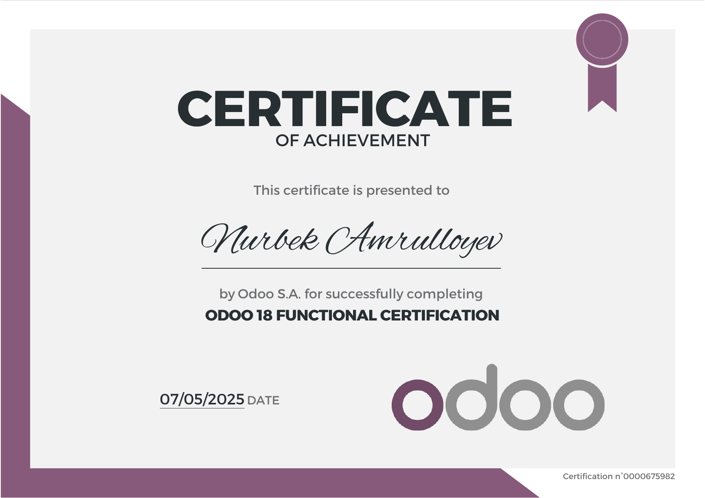

# Nurbek Amrulloyev

**Odoo Developer** · Uzbekistan
🎓 **Odoo 18 Functional Certification** — Odoo S.A.

I build and deploy ERP systems on Odoo. I've delivered **Odoo Enterprise
implementations for several client companies** — manufacturing, trading and
services — and I'm currently building a multi-tenant ERP SaaS product.
Most of my work sits where the business process is messy: shop-floor production,
inventory valuation, and financial reporting that has to actually reconcile.

---

## Certification

Issued by Odoo S.A. · Certificate n° 0000675982 · [original PDF](assets/odoo-18-functional-certification.pdf)

Open to Odoo implementation, customization and integration work.

---

## What I work on

**Odoo** 17 / 18 / 19 — Community and Enterprise · Python · PostgreSQL · OWL (Odoo's frontend framework) · XML/QWeb reports
**Around it** — Django · FastAPI · Docker & Compose · Nginx · Telegram Bot API · REST & MCP servers

---

## Selected work

### Odoo Enterprise implementations

Deployed and customized Odoo Enterprise for several client companies across
manufacturing, trading and services. Typical scope:

- **Inventory valuation & accounting integrity** — FIFO cost layers reconciled
  against the general ledger, landed-cost corrections, and audit tools that show
  *which documents* caused a discrepancy before any fix is applied.
- **Analytic accounting** — automatic category / investor / holding dimensions
  across sales, purchases, treasury and payments, plus wizards that repair
  historical data without touching the GL.
- **Multi-company flows** — intercompany sales and purchases, branch-level
  stock, and per-company access rules.
- **Telegram integrations** — order confirmations, debt and reconciliation
  reports as Excel, payment-due reminders, and multi-account authentication.
- **Mobile REST APIs** for field-agent applications.

### Mebelerp — multi-tenant ERP/CRM SaaS for furniture manufacturing

A full production ERP built on Odoo 18 Community, delivered as a hosted SaaS.

- **CAD → production pipeline.** Parser for GibLab `.project` cutting files (two
  incompatible formats) that turns panel data into a Bill of Materials, cutting
  sheets and CNC operations. Includes an interactive cut-map rendered as an OWL
  SVG widget, printable panel labels with barcodes, and offcut (leftover stock)
  tracking with a "find a piece ≥ this size" search.
- **Shop-floor UI.** Tablet-friendly interface for machine operators — large
  buttons, stage confirmation, material pickup as a warehouse transfer.
- **Sales → manufacturing → warehouse → invoice** as one automated chain, with
  configurable production stages and auto-reconciliation.
- **Control plane.** A separate Django application that provisions tenant
  databases, manages subscriptions and payments, generates per-tenant GitOps
  repositories, and supports admin impersonation. Wildcard-subdomain routing
  with host-based database filtering, behind Nginx + Let's Encrypt.
- **AI layer.** An in-Odoo assistant plus an MCP server (JSON-RPC 2.0 over
  Streamable HTTP) exposing read-only business tools, so Claude or ChatGPT can
  query live company data. Bring-your-own-key, three providers supported.

### Enterprise Manufacturing features, rebuilt on Odoo Community

Odoo's Enterprise edition gates Manufacturing Work Orders, Shop Floor and Quality
behind a licence. After a detailed teardown of the Enterprise implementation, I
rebuilt the missing layer as **nine Community modules**: work orders, work-order
costing, quality checkpoints, employee PIN login, an OWL shop-floor client,
manufacturing reports, and a work-centre load view. Several defects present in the
original implementation were fixed along the way.

---

## Education

**Japan Digital University** — currently studying

---

## Currently learning

Accounting in depth — from double-entry fundamentals through IFRS (IAS 2, IAS 21,
IFRS 15) to Uzbekistan's national standards (NSBU) — because ERP code that touches
the ledger should be written by someone who understands the ledger.

---

<b>🇺🇿 O'zbekcha</b>

 

## Nurbek Amrulloyev — Odoo dasturchi

🎓 **Odoo 18 Functional Certification** — Odoo S.A.

Odoo asosida ERP tizimlarini quraman va joriy qilaman. **Bir necha mijoz
kompaniyalarga Odoo Enterprise'ni joriy qilganman** — ishlab chiqarish, savdo va
xizmat sohalarida — hozir esa ko'p-ijarachili (multi-tenant) ERP SaaS mahsulotini
qurmoqdaman. Asosan biznes jarayoni murakkab bo'lgan joylarda ishlayman: sex
ishlab chiqarishi, ombor baholash (valuation) va haqiqatan ham to'g'ri
yig'iladigan moliyaviy hisobotlar.

### Sertifikat

Odoo S.A. tomonidan berilgan · Sertifikat n° 0000675982 · [asl PDF](assets/odoo-18-functional-certification.pdf)

Odoo joriy qilish, moslashtirish va integratsiya ishlariga ochiqman.

### Texnologiyalar

**Odoo** 17 / 18 / 19 — Community va Enterprise · Python · PostgreSQL · OWL · XML/QWeb hisobotlar
**Qo'shimcha** — Django · FastAPI · Docker & Compose · Nginx · Telegram Bot API · REST va MCP serverlar

### Asosiy ishlarim

#### Odoo Enterprise joriy qilish

Ishlab chiqarish, savdo va xizmat sohasidagi bir necha mijoz kompaniyalarga Odoo
Enterprise joriy qilingan va moslashtirilgan. Odatdagi ish hajmi:

- **Ombor baholash va hisob yaxlitligi** — FIFO tannarx qatlamlarini bosh
  kitob (GL) bilan solishtirish, landed cost tuzatishlari, hamda tuzatishdan
  oldin *qaysi hujjat* farqni keltirganini ko'rsatuvchi audit vositalari.
- **Analitik hisob** — sotuv, xarid, kassa va to'lovlar bo'ylab
  kategoriya / investor / holding o'lchovlarini avtomatik yozish, hamda GL'ga
  tegmasdan tarixiy ma'lumotni tuzatuvchi sehrgarlar.
- **Ko'p-kompaniyali oqimlar** — kompaniyalararo sotuv va xarid, filial
  darajasidagi ombor, har kompaniya uchun kirish huquqlari.
- **Telegram integratsiyalari** — buyurtma tasdig'i, qarz va akt-sverka
  hisobotlari Excel ko'rinishida, to'lov muddati eslatmalari, ko'p-akkaunt
  autentifikatsiya.
- **Mobil REST API'lar** — dala xodimlari ilovalari uchun.

#### Mebelerp — mebel ishlab chiqarish uchun ko'p-ijarachili ERP/CRM SaaS

Odoo 18 Community asosida qurilgan to'liq ishlab chiqarish ERP tizimi.

- **CAD → ishlab chiqarish zanjiri.** GibLab `.project` kesim fayllari uchun
  parser (bir-biriga mos kelmaydigan ikki format) — panel ma'lumotini BoM,
  kesim varaqlari va CNC operatsiyalariga aylantiradi. OWL SVG widget'i
  ko'rinishidagi interaktiv kesim xaritasi, shtrix-kodli panel yorliqlari
  (chop etiladigan), hamda «shu o'lchamdan katta bo'lakni top» qidiruvi bilan
  ostatka (qoldiq material) hisobi.
- **Usta oynasi.** Planshetga moslashtirilgan interfeys — katta tugmalar,
  bosqich tasdiqlash, material olish ombor transferi sifatida.
- **Sotuv → ishlab chiqarish → ombor → faktura** yagona avtomatlashtirilgan
  zanjir; sozlanadigan bosqichlar va avtomatik to'lov solishtirish bilan.
- **Boshqaruv paneli.** Alohida Django ilovasi: ijarachi bazalarini yaratadi,
  obuna va to'lovlarni boshqaradi, har bir mijoz uchun GitOps repozitoriysi
  generatsiya qiladi, admin nomidan kirishni qo'llab-quvvatlaydi. Wildcard
  subdomen marshrutizatsiyasi va host bo'yicha baza filtri, Nginx +
  Let's Encrypt orqasida.
- **AI qatlami.** Odoo ichidagi yordamchi hamda MCP server (Streamable HTTP
  ustidan JSON-RPC 2.0) — kompaniya ma'lumotini faqat o'qish rejimida ochadi,
  shu orqali Claude yoki ChatGPT jonli ma'lumot bilan ishlaydi. Mijozning
  o'z kaliti, uchta provayder.

#### Enterprise Manufacturing funksiyalari — Community'da qayta qurilgan

Odoo Enterprise'da Manufacturing Work Orders, Shop Floor va Quality litsenziya
ostida. Enterprise implementatsiyasini batafsil tahlil qilib, yetishmayotgan
qatlamni **to'qqizta Community modul** ko'rinishida qayta qurdim: ish buyruqlari,
ish buyrug'i tannarxi, sifat nazorati, xodim PIN kirishi, OWL shop-floor
mijozi, ishlab chiqarish hisobotlari va ish markazi yuklamasi. Jarayonda asl
implementatsiyadagi bir nechta nuqson ham tuzatildi.

### Ta'lim

**Japan Digital University** — hozir o'qiyapman

### Hozir o'rganayotganim

Buxgalteriyani chuqur o'rganyapman — ikkiyoqlama yozuv asoslaridan IFRS
(IAS 2, IAS 21, IFRS 15) va NSBU'gacha. Sababi oddiy: bosh kitobga tegadigan
ERP kodini bosh kitobni tushunadigan odam yozishi kerak.

